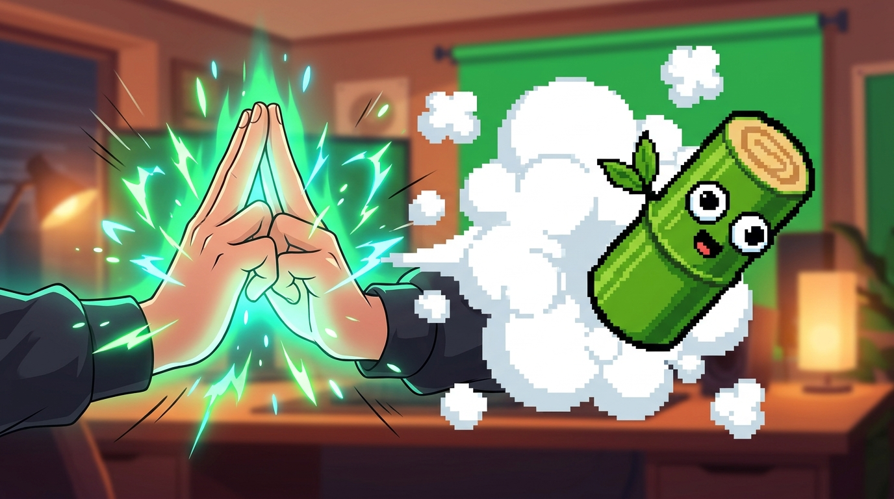
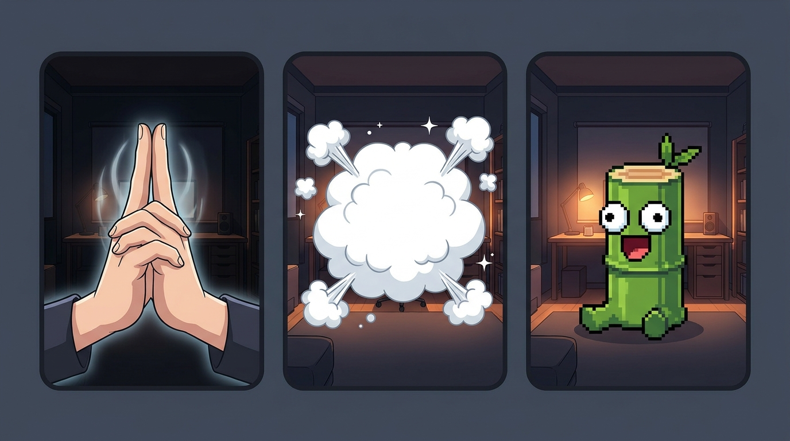

<p align="center">
  
</p>

# Bamboo Jutsu

A real-time webcam filter powered by OpenCV and MediaPipe that swaps your background and lets you transform into a crawling, face-synced pixel-art Naruto bamboo log whenever you perform the ninja hand seal.

---

## How It Works

<p align="center">
   Smoke Poof -> Pixel Bamboo" width="100%" />
</p>

1. **Form the Bamboo Jutsu hand seal** (hands raised together in front of your chest, index & middle fingers pointing straight up, ring & pinky curled).
2. **Smoke screen poof:** Your body disappears behind a burst of pixel-art smoke puffs and the bamboo drops from your head to the bottom of the screen.
3. **Live face & motion sync:** The bamboo crawls along with your movement and copies your eye blinks, gaze, head tilts, and mouth movements while you talk.
4. **Toggle back anytime:** Make the hand seal again (or press `T`) to poof back to normal.

---

## Features

- **Real-time body, hand & face tracking** via MediaPipe Tasks (`PoseLandmarker`, `HandLandmarker`, `FaceLandmarker`, `ImageSegmenter`).
- **Live background replacement** with head-tracked perspective warp/parallax (`custom_bg`, `studio_green`, `solid_green`, or raw `camera`).
- **OBS Virtual Camera output** (`--virtualcam`) that sends a clean feed (without debug overlays) straight to Google Meet, Zoom, or Discord.
- **Auto-downloaded models** on first launch into `models/`.

---

## Quick Setup

### Prerequisites
- Python 3.12 (recommended for MediaPipe & OpenCV compatibility on Windows)
- Webcam
- *(Optional, for Google Meet / Discord)* [OBS Studio](https://obsproject.com/) installed for its Virtual Camera driver

### Install

```bash
uv venv --python 3.12 .venv
uv pip install --python .venv/Scripts/python.exe -r requirements.txt
```

Or with standard `pip`:

```bash
python -m venv .venv
.venv\Scripts\activate
pip install -r requirements.txt
```

---

## Usage

Run the local preview window:

```bash
.venv\Scripts\python.exe main.py
```

Stream directly to **OBS Virtual Camera** (for Google Meet / Discord):

```bash
.venv\Scripts\python.exe main.py --virtualcam
```

Then open **Google Meet → Settings → Video → Camera** and pick **OBS Virtual Camera**.

### CLI Options

| Flag | Default | Description |
| :--- | :--- | :--- |
| `--camera` | `0` | Webcam device index |
| `--width` | `854` | Output frame width in pixels (height scales proportionally) |
| `--virtualcam` | `off` | Stream clean output to OBS Virtual Camera |
| `--raw` | `off` | Show untouched camera feed without processing |

---

## Controls

| Key | Action |
| :--- | :--- |
| `G` | Cycle background (`custom_bg` → `studio_green` → `solid_green` → `camera`) |
| `L` | Toggle pose & hand landmarks in preview |
| `M` | Toggle mirror flip |
| `T` | Manually trigger/toggle Bamboo Jutsu |
| `Q` / `Esc` | Quit |

---

## Project Structure

```text
bamboo-jutsu/
├── main.py               # Camera capture, segmentation, virtual cam & UI loop
├── gesture_detector.py   # Pose + finger geometry hand-seal detector
├── jutsu_effects.py      # Smoke burst, falling/crawling bamboo & face sync
├── requirements.txt      # Python dependencies
├── .gitignore
└── assets/
    ├── bamboo_log.png    # Transparent pixel-art bamboo sprite
    ├── custom_bg.png     # Perspective-warped studio room background
    ├── green_screen.png  # Studio chroma-key green screen
    ├── smoke_1.png       # CC0 smoke puff sprite sheet (OpenGameArt)
    ├── banner.png        # README hero illustration
    └── showcase.png      # README 3-step showcase illustration
```

---

## Credits

- Smoke puff sprite sheet (`assets/smoke_1.png`) from [OpenGameArt — Smoke Puff](https://opengameart.org/content/smoke-puff) (CC0).
